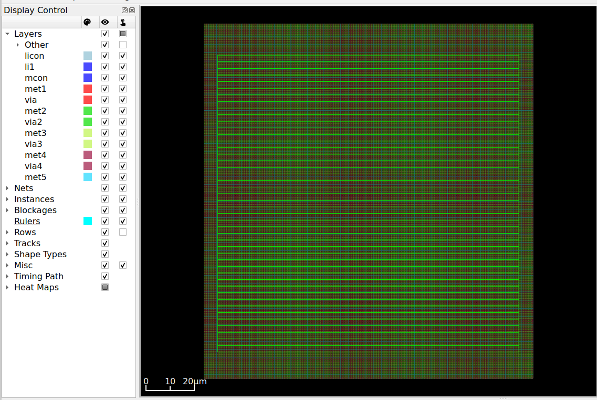
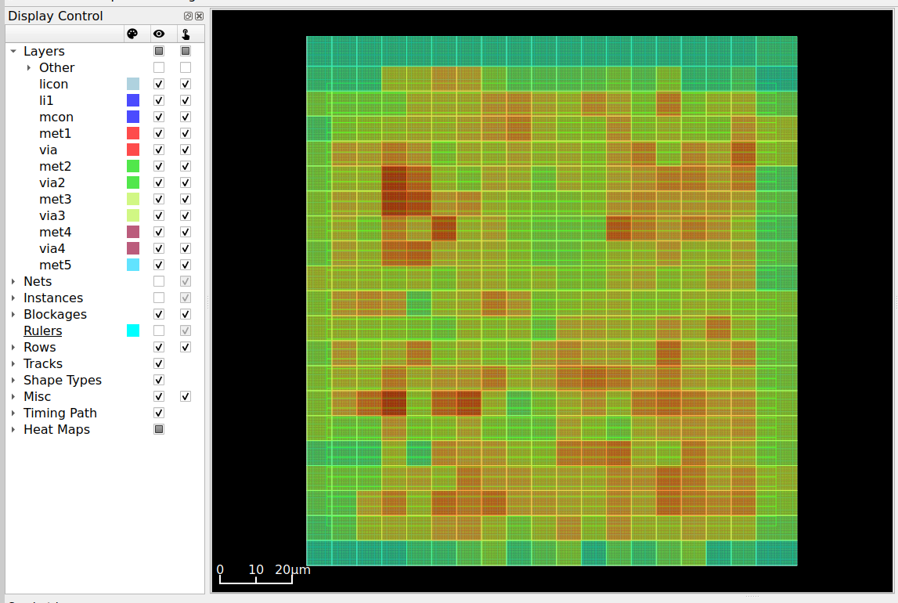
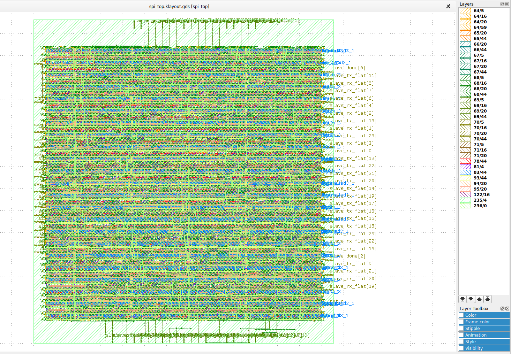

# RTL-to-GDSII Implementation of a Multi-Slave SPI Protocol Controller

A parameterized 4-slave SPI master/slave system in Verilog, supporting all four SPI modes (CPOL/CPHA), taken from RTL through synthesis, place-and-route, timing analysis and GDSII generation using the open-source **Yosys + OpenLane 2 + Sky130** flow.

## Features

- Parameterized master (`DATA_WIDTH`, `SLAVES`, `CLK_DIV`, `CPOL`, `CPHA`) and slave modules
- All four SPI modes (0-3), full-duplex transfers
- Slaves instantiated with a `generate` loop, so the slave count scales by changing one parameter
- **ASIC-oriented design choices**
  - Shared MISO bus replaced with an explicit mux (no internal tri-state buffers)
  - Single clock domain: slaves detect SCLK edges through a 2-flop synchronizer instead of using SCLK as a clock, so no generated-clock constraint is needed

## Repository layout

```
rtl/        spi_master.v, spi_slave.v, spi_top.v
tb/         self-checking testbenches
openlane/   OpenLane 2 configuration
docs/       screenshots and saved metrics
```

(Adjust to match your actual folders.)

## Verification

- `tb_spi_top.v`: single-mode regression (Mode 0, all 4 slaves)
- `tb_spi_all_modes.v`: four DUT instances (one per mode), 20 repetitions x 4 modes x 4 slaves = **320 randomized full-duplex transfers, 0 failures** at `CLK_DIV=4`
- Verilator lint clean

Two bugs were found and fixed through the all-modes testbench:

1. **First bit dropped in CPHA=1 modes.** The shift register advanced before the MSB was ever presented.
2. **Race at the end of CPHA=1 transfers.** The master cleared MOSI/SS in the same cycle the slave's synchronizer (about 2 cycles behind) sampled the final bit. Fixed by giving the slave's data-phase edges priority over an SS deassertion, and adding a short hold state in the master before cleanup.

**Constraint:** keep `CLK_DIV >= 4`. The SCLK synchronizer cannot reliably track faster toggling; `CLK_DIV=2` corrupts transfers.

## Synthesis results (Yosys, Sky130 HD)

| Metric | Value |
|---|---|
| Total cells | 519 |
| Flip-flops | 165 (161 `dfrtp`, 4 `dfstp`) |
| Chip area | 7,742.4 µm² |
| Sequential share of area | 56% |

## Physical design results (OpenLane 2, Sky130)

Initial run, clock constraint **20 ns (50 MHz)**.

| Metric | Value |
|---|---|
| Die dimensions | 135.48 µm x 146.2 µm |
| Die area | 19,807 µm² |
| Rows | 45 |
| I/O pins | 90 |
| Worst setup slack (post-route, all corners) | +13.50 ns |
| Worst hold slack (post-route, all corners) | +0.11 ns |
| Setup / hold TNS | 0.0 / 0.0 |
| Setup / hold violations | 0 / 0 |
| Max cap / max slew violations (post-route) | 0 / 0 |
| Estimated critical path | about 6.5 ns |

Timing was analyzed across all nominal, min and max corners (tt/ss/ff). Setup slack is tightest at the slow corner (ss, 100 C, 1.60 V); hold is tightest at the fast corner (ff, -40 C, 1.95 V).

### Sign-off status

| Check | Result |
|---|---|
| DRC | TODO |
| LVS | TODO |
| Antenna | TODO |
| Power | TODO |
| Final instance count / utilization | TODO |

Fill these from `final/metrics.json` of the run.

### Layout

**Floorplan** (die with power grid, before placement)



**Final database** (OpenROAD, <HEATMAP NAME> overlay)



**GDSII** (KLayout)



## Run history

One variable changes per run.

| Run | Clock | Change | Die area | Setup WS | Hold WS | DRC | LVS |
|---|---|---|---|---|---|---|---|
| baseline | 20 ns | initial run | 19,807 µm² | +13.50 ns | +0.11 ns | TODO | TODO |

## How to run

Simulation (Icarus Verilog):

```bash
iverilog -g2005 -o sim rtl/*.v tb/tb_spi_all_modes.v && vvp sim
```

ASIC flow (OpenLane 2, inside `nix-shell` in the openlane2 checkout):

```bash
openlane --run-tag <name> /path/to/config.json
```

## Tools

Verilog, Icarus Verilog, Verilator, Vivado (FPGA reference), Yosys, OpenLane 2, OpenROAD, KLayout, Sky130 PDK.
